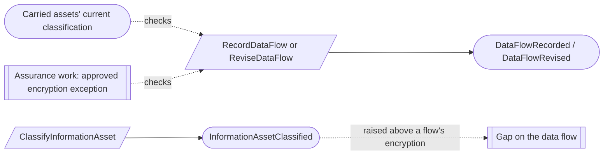

# Technology and information inventory

Status: **locked**, 2026-11-03. Hand-authored source of truth for this context.

## Purpose

This context records the technology, information, data flows, locations and
operational processes the scoped system depends on, at the granularity a small
team manages: accounts and environments, not individual resources (M0-D08). The
inventory in the product is authoritative; cloud consoles, MDM and repository
hosts are only for discovering gaps.

**Owns:** technology components, information assets, data flows, locations and
operational processes.

**Does not own:**

| Concern | Owner |
| --- | --- |
| Cloud accounts | Application inventory: a cloud account is a `SystemInstance` of kind `cloud_account` (TI-01) |
| Owners | Workforce assurance (`Person`) |
| Approved exceptions to encryption rules | Assurance work (waivers) |
| Retention periods | Retention (M0-D16); assets hold a reference |
| Written procedures | Policies; a procedure is policy content, never an operational process |
| Connectors | Deferred: none is built now (M0-D08) |

## Language

| Term | Meaning |
| --- | --- |
| Technology component | One governed environment, network, data store, repository or endpoint class. |
| Endpoint class | A group of devices, such as "managed macOS laptops", recorded by count and management source. Individual devices are out of scope. |
| Information asset | A body of information with one classification (`public`, `internal`, `confidential`, `restricted`), a retention reference and an owner. |
| Data flow | Information moving from a service or system instance to a data store or an external party, with its purpose and encryption in transit and at rest. |
| Location | A place the system depends on, such as an office, data center or cloud region, with a kind. |
| Operational process | A governed business process, such as change management or onboarding. |

## Aggregates

All five aggregates follow the same lifecycle: active, then retired. Retirement
is final, keeps the identity for history, and needs a reason; something revived
later is a new record (TI-03). Changes are recorded as named facts, not one
generic revision (as WF-03).

### TechnologyComponent

**Identity:** `TenantId` + `ComponentId`.

**Invariant:** one component has one category for life (`environment`, `network`,
`data_store`, `repository`, `endpoint_class`), a governed name, an owner, an
environment reference, and a location reference.

- An endpoint class also has a count and a management source.
- A component that lives in a cloud account references that account's system
  instance (TI-01).

| Command | Who | Accepts when | Emits |
| --- | --- | --- | --- |
| RecordTechnologyComponent | Compliance Lead or Contributor | `ComponentId` is new; category fields complete | TechnologyComponentRecorded |
| ChangeTechnologyComponentDetails | Compliance Lead or Contributor | Active | TechnologyComponentDetailsChanged |
| ChangeTechnologyComponentOwner | Compliance Lead | Active | TechnologyComponentOwnerChanged |
| RetireTechnologyComponent | Compliance Lead | Active; reason given | TechnologyComponentRetired |

| Event | Carries |
| --- | --- |
| TechnologyComponentRecorded | tenant, component, category, name, owner, environment, location, system instance (if any), endpoint count and management source (endpoint class), recorded by |
| TechnologyComponentDetailsChanged | tenant, component, changed fields, changed by |
| TechnologyComponentOwnerChanged | tenant, component, previous owner, new owner, changed by |
| TechnologyComponentRetired | tenant, component, effective at, reason, retired by |

### InformationAsset

**Identity:** `TenantId` + `InformationAssetId`.

**Invariant:** one asset has exactly one classification, one retention reference
and one owner.

- Raising the classification is allowed even when flows that carry the asset no
  longer meet the encryption rule; those flows show as gaps (TI-02).

| Command | Who | Accepts when | Emits |
| --- | --- | --- | --- |
| RecordInformationAsset | Compliance Lead or Contributor | `InformationAssetId` is new; one classification | InformationAssetRecorded |
| ClassifyInformationAsset | Compliance Lead | Active; classification differs | InformationAssetClassified |
| ChangeInformationAssetDetails | Compliance Lead or Contributor | Active | InformationAssetDetailsChanged |
| ChangeInformationAssetOwner | Compliance Lead | Active | InformationAssetOwnerChanged |
| RetireInformationAsset | Compliance Lead | Active; reason given | InformationAssetRetired |

| Event | Carries |
| --- | --- |
| InformationAssetRecorded | tenant, asset, name, classification, retention reference, owner, recorded by |
| InformationAssetClassified | tenant, asset, previous classification, new classification, classified by |
| InformationAssetDetailsChanged | tenant, asset, changed fields, changed by |
| InformationAssetOwnerChanged | tenant, asset, previous owner, new owner, changed by |
| InformationAssetRetired | tenant, asset, effective at, reason, retired by |

Retiring an asset does not change its data flows.

### DataFlow

**Identity:** `TenantId` + `DataFlowId`.

**Invariant:** one flow has one source (a client service or system instance), one
destination (a data store or an external party), one or more information assets,
a purpose, and explicit `encrypted_in_transit` and `encrypted_at_rest` flags. Its
versions are effective-dated, and the effective date never moves backward.

- When a carried asset is `confidential` or `restricted`, both encryption flags
  must be true unless an approved exception is referenced. This is checked when
  the flow is recorded or changed, using each asset's current classification.

| Command | Who | Accepts when | Emits |
| --- | --- | --- | --- |
| RecordDataFlow | Compliance Lead or Contributor | `DataFlowId` is new; source, destination and assets active; rules hold | DataFlowRecorded |
| ReviseDataFlow | Compliance Lead or Contributor | Active; source, destination and assets active; rules hold; effective date not earlier | DataFlowRevised |
| RetireDataFlow | Compliance Lead | Active; reason given | DataFlowRetired |

A data flow is a versioned statement, so its changes are one `DataFlowRevised`
fact carrying the full new version.

| Event | Carries |
| --- | --- |
| DataFlowRecorded | tenant, flow, version, effective at, source, destination, information assets, purpose, encrypted in transit, encrypted at rest, exception reference (if any), recorded by |
| DataFlowRevised | tenant, flow, version, effective at, the full new version, revised by |
| DataFlowRetired | tenant, flow, effective at, reason, retired by |

### Location

**Identity:** `TenantId` + `LocationId`.

**Invariant:** one location has one kind for life and a name. Among active
locations of the same kind, names should be unique: advice checked when a name is
set, with the `duplicate_location_name` gap and a rename to repair it (TI-04).

| Command | Who | Accepts when | Emits |
| --- | --- | --- | --- |
| RecordLocation | Compliance Lead or Contributor | `LocationId` is new; name unused within kind | LocationRecorded |
| RenameLocation | Compliance Lead or Contributor | Active; name unused within kind | LocationRenamed |
| ChangeLocationDetails | Compliance Lead or Contributor | Active | LocationDetailsChanged |
| RetireLocation | Compliance Lead | Active; reason given | LocationRetired |

A retired location's name becomes available again.

| Event | Carries |
| --- | --- |
| LocationRecorded | tenant, location, kind, name, details, recorded by |
| LocationRenamed | tenant, location, previous name, new name, renamed by |
| LocationDetailsChanged | tenant, location, changed fields, changed by |
| LocationRetired | tenant, location, effective at, reason, retired by |

### OperationalProcess

**Identity:** `TenantId` + `OperationalProcessId`.

**Invariant:** one process has one type for life, a name, an owner and a
description. Names should be unique among active processes: advice checked when
a name is set, with the `duplicate_process_name` gap and a rename to repair it
(TI-04).

| Command | Who | Accepts when | Emits |
| --- | --- | --- | --- |
| RecordOperationalProcess | Compliance Lead or Contributor | `OperationalProcessId` is new; name unused | OperationalProcessRecorded |
| RenameOperationalProcess | Compliance Lead or Contributor | Active; name unused | OperationalProcessRenamed |
| ChangeOperationalProcessDetails | Compliance Lead or Contributor | Active | OperationalProcessDetailsChanged |
| ChangeOperationalProcessOwner | Compliance Lead | Active | OperationalProcessOwnerChanged |
| RetireOperationalProcess | Compliance Lead | Active; reason given | OperationalProcessRetired |

| Event | Carries |
| --- | --- |
| OperationalProcessRecorded | tenant, process, type, name, owner, description, recorded by |
| OperationalProcessRenamed | tenant, process, previous name, new name, renamed by |
| OperationalProcessDetailsChanged | tenant, process, changed fields, changed by |
| OperationalProcessOwnerChanged | tenant, process, previous owner, new owner, changed by |
| OperationalProcessRetired | tenant, process, effective at, reason, retired by |

## Flows

This context has no reactors. Each command checks the facts it needs against
current state. Consumers such as risk, the system description and controls react
to its facts in their own contexts.

### Data flow encryption

A raised classification is recorded as the truth; flows that no longer meet the
rule show a gap until they are revised (TI-02, [CV-08](conventions.md#guards-and-reviews)).

## Computed gaps

| Gap | Shown when |
| --- | --- |
| `duplicate_location_name` | Two active locations of the same kind share a name |
| `duplicate_process_name` | Two active operational processes share a name |

## Decisions

Jev answers are from `jev-1.14.0`, 2026-11-03. A yes is ≥ 0.8 and a no is ≤ 0.2.
Anything in between is settled by common sense, with the reasoning stated.

| ID | Decision | Evidence |
| --- | --- | --- |
| TI-01 | Cloud accounts are recorded only as system instances; no cloud-account component. | 0.75. M0-D08: cloud-account components correspond one-to-one with system instances and are not duplicated. |
| TI-02 | Raising a classification is allowed, and flows that no longer meet the encryption rule show as gaps. | 0.74. Same pattern as an overdue service-identity review: show the gap, don't block the truth. |
| TI-03 | Retirement is final for all inventory records; something revived is a new record. | Location restorable: 0.49; process retirement final: 0.46, both even. Common sense: the same rule as applications and work relationships keeps lifecycles simple. This replaces the earlier allowance to reactivate assets and locations. |
| TI-04 | Name uniqueness for locations and processes is advice with a duplicate gap and a rename to repair it; there are no name-claim aggregates or name-change processes. | Small independent aggregates (as AI-03, CV-05). |

## Open questions

None at this time.

## Superseded owners

| Old owner | Becomes |
| --- | --- |
| TechnologyComponent | TechnologyComponent (no `cloud_account` category; TI-01) |
| InformationAsset | InformationAsset |
| DataFlow | DataFlow |
| Location | Location |
| OperationalProcess | OperationalProcess |
| LocationNameClaim, OperationalProcessNameClaim | Removed (TI-04) |
| LocationNameChangeProcess, OperationalProcessNameChangeProcess | Removed (TI-04) |
