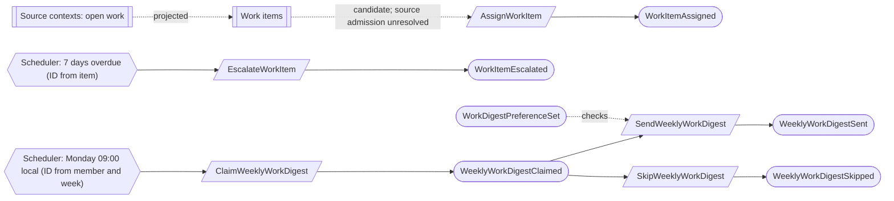

# Work queue

Status: **design under review**, 2026-11-05. Hand-authored source of truth for this context.
It follows the [context conventions](conventions.md).

## Purpose

Work queue shows each person the open work they are accountable for, lets the
team assign it, escalates overdue work, and sends one weekly digest email
(M0-D15). The queue itself is a projection of the source workflows; completing
work always happens in the source.

**Owns:** work item assignments, digest preferences and weekly digests.

**Does not own:**

| Concern | Owner |
| --- | --- |
| Which work exists, its due date and when it is done | The source contexts: control occurrences, evidence requests, pending reviews, corrective actions, access review items, campaign participants, gaps |
| Who may act on the work | The source context's rules; assignment never grants authority |
| Member email addresses | [Platform access](platform-access.md) |

## Language

| Term | Meaning |
| --- | --- |
| Work item | A projection of one open piece of source work, keyed by the source record and, where a new round restarts the work, its revision. |
| Assignee | The person accountable for an item: assigned, claimed or delegated. A team item has no assignee until claimed. |
| Escalation | A system or assignee action that makes an overdue item visible to the Compliance Lead without reassigning it. |
| Digest week | A member's local Monday 00:00 to the next Monday, keyed by its Monday date. |

## Aggregates

### WorkItemAssignment

**Identity:** `TenantId` + `WorkItemKey`.

**Invariant:** one work item has one current assignee and at most one
escalation. Every action is attributed. The accepted M0-D15 rule also prohibits
assigning a person the source workflow would refuse; a read of another owner
alone cannot enforce that rule against a concurrent source change. Its
authoritative admission protocol is unresolved below.

- A new round of source work, such as a reopened finding, has a new key, so an
  earlier assignment never carries over (M0-D15).
- An item 7 days overdue is escalated by the scheduler once, with an ID derived
  from the item ([CV-09](conventions.md#reactors), WQ-01).
- Assignment does not grant permission to act. Source commands independently
  enforce their current eligibility and authorization rules.

| Command | Who | Accepts when | Emits |
| --- | --- | --- | --- |
| AssignWorkItem | Compliance Lead or Org Admin | The item is open in its source; assignee eligible | WorkItemAssigned |
| ClaimWorkItem | A member of the item's team with the source's required role | Unassigned team item | WorkItemAssigned |
| DelegateWorkItem | The current assignee | Delegate eligible | WorkItemAssigned |
| EscalateWorkItem | Any assignee, or the scheduler at 7 days overdue | Not escalated; a repeat is a no-op | WorkItemEscalated |

| Event | Carries |
| --- | --- |
| WorkItemAssigned | tenant, work item key, source record, how (`assigned`, `claimed`, `delegated`), previous assignee, assignee, by |
| WorkItemEscalated | tenant, work item key, to (Compliance Lead), reason, by (member or system) |

### WorkDigestPreference

**Identity:** `TenantId` + `MemberId`.

**Invariant:** one member has one digest setting, `on` or `off`, and one valid
time zone (or none, meaning UTC). In-app reminders cannot be turned off.

| Command | Who | Accepts when | Emits |
| --- | --- | --- | --- |
| SetWorkDigestPreference | The member | Time zone valid; differs from the current setting | WorkDigestPreferenceSet |

| Event | Carries |
| --- | --- |
| WorkDigestPreferenceSet | tenant, member, digest, time zone |

### WeeklyWorkDigest

**Identity:** `TenantId` + `MemberId` + `WeekOf` (R2 digest decision).

**Invariant:** one tenant/member/week has one durable dispatch, claimed once;
its outcome is recorded against that identity and a missed week is never
backfilled. SMTP acceptance is not recipient delivery, and there is no
exactly-once physical delivery guarantee. Membership, verified email, preference
and queue visibility are rechecked just before composing and sending.

- At first claim, freeze the member's local week, resolved time zone and Monday
  09:00 scheduled UTC instant; later preference changes apply to an unclaimed
  week. Resume the same claim on replay (CV-09).
- The R2 delivery decision governs retry, including a configured attempt limit
  and deadline. A definite transient non-acceptance may be retried; an
  ambiguous outcome is **not** automatically resent. IT may authorize a retry
  in the same window only after evidence establishes non-acceptance. SMTP has
  no atomic commit with our outcome and a stable message identity does not
  deduplicate delivery (WQ-02).
- The email contains the selected authorized work across eligible programs.
  Page or stream the source-derived queue; do not build one aggregate or event
  containing all item keys. Ordered paging and deduplication in bounded memory
  require a qualified stable sort/keyset or an explicit external workspace; the
  word "stream" does not by itself prove either property.
  Each source continues to own its work. A dispatch outcome records no roster,
  item payloads, or message body; individual work references remain with their
  respective source owners. A recorded outcome alone does not reconstruct the
  exact email's item set. Exact cross-source visibility at send remains an open
  implementation design question, not a guarantee supplied by a projection.
- The nonempty check is a candidate single authorized work-item witness, not a
  write decision that enumerates all work. The witness must still be valid at
  the decision point; source closure, permission revocation and send can race.
  No current product rule has been changed to permit stale or unauthorized
  content, and the authoritative dispatch/disclosure boundary remains open.

| Command | Who | Accepts when | Emits |
| --- | --- | --- | --- |
| ClaimWeeklyWorkDigest | Scheduler | First claim for member and week | WeeklyWorkDigestClaimed |
| SendWeeklyWorkDigest | Scheduler | Claimed; checks pass; digest nonempty; no unresolved attempt | WeeklyWorkDigestAttemptStarted; then WeeklyWorkDigestSent, WeeklyWorkDigestAttemptFailed or WeeklyWorkDigestOutcomeUnknown |
| SkipWeeklyWorkDigest | Scheduler | Claimed; no attempt that may have been accepted; a check fails or the digest is empty | WeeklyWorkDigestSkipped |
| AuthorizeWeeklyWorkDigestRetry | IT operator | Unknown attempt; same window; evidence establishes non-acceptance; limits permit | WeeklyWorkDigestRetryAuthorized |

| Event | Carries |
| --- | --- |
| WeeklyWorkDigestClaimed | tenant, member, week of, time zone, scheduled UTC instant, stable message identity |
| WeeklyWorkDigestAttemptStarted | tenant, member, week of, attempt identity, started at |
| WeeklyWorkDigestSent | tenant, member, week of, attempt identity, relay accepted at |
| WeeklyWorkDigestAttemptFailed | tenant, member, week of, attempt identity, definite transient or permanent failure, redacted category, terminal retry exhaustion if applicable |
| WeeklyWorkDigestOutcomeUnknown | tenant, member, week of, attempt identity, time, redacted category |
| WeeklyWorkDigestRetryAuthorized | tenant, member, week of, attempt identity, operator, time, evidence reference, rationale |
| WeeklyWorkDigestSkipped | tenant, member, week of, reason (`empty`, `opted_out`, `no_verified_email`, `inactive_member`) |

## Flows

Diagrams follow [CV-01](conventions.md#flow-diagrams).

## Decisions

Jev answers are from `jev-1.14.0`, 2026-11-03. The historical 0.8 and 0.2
thresholds were triage conventions, not calibrated probabilities of correctness;
conflicting or inconclusive cases remain open until source evidence resolves them.

| ID | Decision | Evidence |
| --- | --- | --- |
| WQ-01 | An overdue item is escalated automatically once; escalation adds visibility and never reassigns. | 0.57. M0-D15. |
| WQ-02 | An ambiguous SMTP outcome is held for IT; a same-window retry needs evidence of non-acceptance. | Accepted [R2 delivery decision](../decisions/r2-weekly-work-digest-delivery.md), which supersedes the earlier model-based retry choice. |

## Open questions

- **Assignment admission:** specify how the source owner authoritatively admits
  an assignee while eligibility or open state changes concurrently, including
  refusal, delayed or duplicate messages and recovery. A stale source read and
  later source-action refusal do not prove M0-D15's assignment rule.
- **Digest visibility and enumeration:** specify a bounded-memory, paged
  cross-program enumeration and deduplication with current authorization at
  dispatch, including how a change during assembly or sending is handled. Do
  not claim a globally atomic cross-source snapshot without a mechanism.

## Superseded owners

| Old owner | Becomes |
| --- | --- |
| WorkItemAssignment | WorkItemAssignment (`WorkAssignmentLegacyHistoryImported` removed) |
| WorkDigestPreference | WorkDigestPreference |
| WeeklyWorkDigest, WorkDigestDispatch | WeeklyWorkDigest (one member/week dispatch and its bounded attempt outcomes) |
