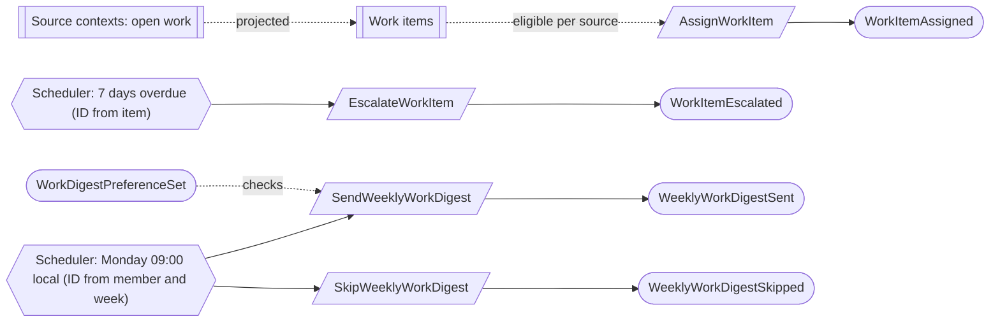

# Work queue

Status: **locked**, 2026-11-03. Hand-authored source of truth for this context.
It follows the [context conventions](conventions.md).

## Purpose

Work queue shows each person the open work they are accountable for, lets the
team assign it, escalates overdue work, and sends one weekly digest email
(M0-D15). The queue itself is a projection of the source workflows; completing
work always happens in the source.

**Owns:** work item assignments, digest preferences and weekly digests.

**Does not own:**

| Concern | Owner |
| --- | --- |
| Which work exists, its due date and when it is done | The source contexts: control occurrences, evidence requests, pending reviews, corrective actions, access review items, campaign participants, gaps |
| Who may act on the work | The source context's rules; assignment never grants authority |
| Member email addresses | [Platform access](platform-access.md) |

## Language

| Term | Meaning |
| --- | --- |
| Work item | A projection of one open piece of source work, keyed by the source record and, where a new round restarts the work, its revision. |
| Assignee | The person accountable for an item: assigned, claimed or delegated. A team item has no assignee until claimed. |
| Escalation | A system or assignee action that makes an overdue item visible to the Compliance Lead without reassigning it. |
| Digest week | A member's local Monday 00:00 to the next Monday, keyed by its Monday date. |

## Aggregates

### WorkItemAssignment

**Identity:** `TenantId` + `WorkItemKey`.

**Invariant:** one work item has one current assignee and at most one
escalation. Every action is attributed, and none assigns a person the source
workflow would refuse (checked against current state,
[CV-05](conventions.md#guards-and-reviews)).

- A new round of source work, such as a reopened finding, has a new key, so an
  earlier assignment never carries over (M0-D15).
- An item 7 days overdue is escalated by the scheduler once, with an ID derived
  from the item ([CV-09](conventions.md#reactors), WQ-01).

| Command | Who | Accepts when | Emits |
| --- | --- | --- | --- |
| AssignWorkItem | Compliance Lead or Org Admin | The item is open in its source; assignee eligible | WorkItemAssigned |
| ClaimWorkItem | A member of the item's team with the source's required role | Unassigned team item | WorkItemAssigned |
| DelegateWorkItem | The current assignee | Delegate eligible | WorkItemAssigned |
| EscalateWorkItem | Any assignee, or the scheduler at 7 days overdue | Not escalated; a repeat is a no-op | WorkItemEscalated |

| Event | Carries |
| --- | --- |
| WorkItemAssigned | tenant, work item key, source record, how (`assigned`, `claimed`, `delegated`), previous assignee, assignee, by |
| WorkItemEscalated | tenant, work item key, to (Compliance Lead), reason, by (member or system) |

### WorkDigestPreference

**Identity:** `TenantId` + `MemberId`.

**Invariant:** one member has one digest setting, `on` or `off`, and one valid
time zone (or none, meaning UTC). In-app reminders cannot be turned off.

| Command | Who | Accepts when | Emits |
| --- | --- | --- | --- |
| SetWorkDigestPreference | The member | Time zone valid; differs from the current setting | WorkDigestPreferenceSet |

| Event | Carries |
| --- | --- |
| WorkDigestPreferenceSet | tenant, member, digest, time zone |

### WeeklyWorkDigest

**Identity:** `TenantId` + `MemberId` + `WeekOf` (R2 digest decision).

**Invariant:** one member gets at most one digest per week, sent or skipped once,
and a missed week is never backfilled. Membership, verified email, preference
and queue visibility are rechecked just before sending.

- The scheduler issues it at Monday 09:00 in the member's time zone, freezing the
  zone and week (CV-09).
- An unknown delivery outcome is retried automatically with the same message
  identity (WQ-02).

| Command | Who | Accepts when | Emits |
| --- | --- | --- | --- |
| SendWeeklyWorkDigest | Scheduler | Not sent or skipped; checks pass and the digest is not empty | WeeklyWorkDigestSent |
| SkipWeeklyWorkDigest | Scheduler | Not sent or skipped; a check fails or the digest is empty | WeeklyWorkDigestSkipped |

| Event | Carries |
| --- | --- |
| WeeklyWorkDigestSent | tenant, member, week of, time zone, items listed (keys), destination, sent at |
| WeeklyWorkDigestSkipped | tenant, member, week of, reason (`empty`, `opted_out`, `no_verified_email`, `inactive_member`) |

## Flows

Diagrams follow [CV-01](conventions.md#flow-diagrams).

## Decisions

Jev answers are from `jev-1.14.0`, 2026-11-03. A yes is ≥ 0.8 and a no is ≤ 0.2.
Anything in between is settled by common sense, with the reasoning stated.

| ID | Decision | Evidence |
| --- | --- | --- |
| WQ-01 | An overdue item is escalated automatically once; escalation adds visibility and never reassigns. | 0.57. M0-D15. |
| WQ-02 | An unknown digest delivery is retried automatically with the same message identity, not held for an operator. | Holding for an operator: 0.30. Common sense: CV-03; a rare duplicate email does little harm. |

## Open questions

None at this time.

## Superseded owners

| Old owner | Becomes |
| --- | --- |
| WorkItemAssignment | WorkItemAssignment (`WorkAssignmentLegacyHistoryImported` removed) |
| WorkDigestPreference | WorkDigestPreference |
| WeeklyWorkDigest, WorkDigestDispatch | WeeklyWorkDigest (sent or skipped; delivery attempts are technical) |
