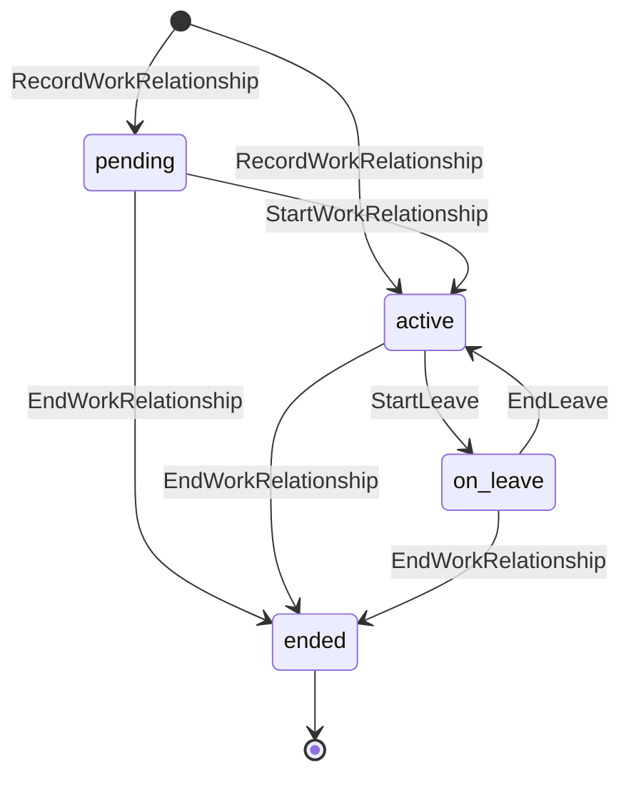
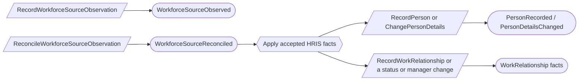
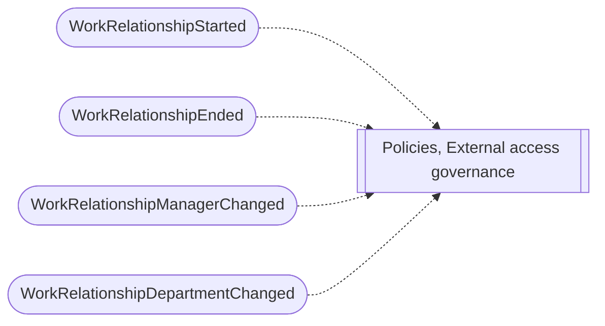

# Workforce assurance

Status: **locked**, 2026-11-03. Hand-authored source of truth for this context.

## Purpose

Workforce assurance records who works for the organization, on what terms, and
which non-human identities exist and who is accountable for them (M0-D06). Other
contexts react to joiners, movers and leavers. Workforce records never grant
platform access, revoke outside access, or decide a review outcome.

**Owns:** people, work relationships, service identities (non-human identities),
and workforce source observations with their reconciliation.

**Does not own:**

| Concern | Owner |
| --- | --- |
| Platform members and sign-in | Platform access; a person is linked to members, never merged with them |
| Accounts and entitlements at outside systems | External access governance |
| Acknowledgement and training campaigns | Policies |
| Binding imported owner names to people | The importing context (Application inventory) |
| Roster file import | Deferred until the first client's HRIS export shape is known (#347) |

## Language

| Term | Meaning |
| --- | --- |
| Person | The stable identity of someone in the workforce. Never ended. |
| Work relationship | One person's employment or engagement under one worker identifier: worker type, status, dates, manager, department and, for external collaborators, a sponsor. |
| Worker identifier | The stable ID of a work relationship: the HRIS worker ID, or an organization-maintained ID for a manual roster. An external source ID is provenance only. |
| Worker type | `employee`, `contractor` or `external_collaborator`. |
| Service identity | A non-human identity (workload, service, automation, bot, integration, or shared account) with one accountable owner. |
| Source observation | One revision of one record from a workforce source (HRIS or identity-provider directory), waiting for or carrying a reconciliation decision. |
| Restricted workforce fields | Personal contact details, the reason for an employment status, and the manager chain. Readable only with an explicit grant; redacted from lists, exports, search and counts (M0-D06). |

## Aggregates

### Person

**Identity:** `TenantId` + `PersonId`.

**Invariant:** one person has one display name, one work email, optional
personal contact details (restricted), and any number of linked platform members.
A person is never ended or retired (WF-02).

- A platform member can be linked to at most one person. Linking is refused if the
  member is already linked to someone else (WF-05).

| Command | Who | Accepts when | Emits |
| --- | --- | --- | --- |
| RecordPerson | Compliance Lead or Org Admin, or reactor | `PersonId` is new | PersonRecorded |
| ChangePersonDetails | Compliance Lead or Org Admin, or reactor | Details differ | PersonDetailsChanged |
| LinkPersonToMember | Org Admin | Member not linked to another person | PersonLinkedToMember |
| UnlinkPersonFromMember | Org Admin | Linked | PersonUnlinkedFromMember |

| Event | Carries |
| --- | --- |
| PersonRecorded | tenant, person, display name, work email, personal contact (restricted), recorded by |
| PersonDetailsChanged | tenant, person, changed fields, changed by |
| PersonLinkedToMember | tenant, person, user, linked by |
| PersonUnlinkedFromMember | tenant, person, user, unlinked by |

### WorkRelationship

**Identity:** `TenantId` + worker identifier. The worker identifier belongs to one
person for good.

**Invariant:** one relationship has one person, one worker type and one status
lifecycle. Its dates agree with its status: an ended relationship has an end
date that is not before its start date.

- Nobody is their own manager or sponsor.
- An external collaborator has an accountable internal sponsor, who must be a
  person with an active work relationship when named. If the sponsor later leaves,
  the collaborator shows as unsponsored work (WF-06).
- A rehire is a new work relationship; an ended one stays ended (WF-01).
- Each change is its own named fact, so other contexts react to exactly what
  changed (WF-03).

| Command | Who | Accepts when | Emits |
| --- | --- | --- | --- |
| RecordWorkRelationship | Compliance Lead or Org Admin, or reactor | Worker identifier is new; person exists | WorkRelationshipRecorded |
| StartWorkRelationship | Same | Pending | WorkRelationshipStarted |
| StartLeave | Same | Active | WorkRelationshipLeaveStarted |
| EndLeave | Same | On leave | WorkRelationshipLeaveEnded |
| EndWorkRelationship | Same | Not ended; end date not before start | WorkRelationshipEnded |
| ChangeManager | Same | Not ended; not self | WorkRelationshipManagerChanged |
| ChangeDepartment | Same | Not ended | WorkRelationshipDepartmentChanged |
| ChangeSponsor | Same | External collaborator; sponsor active; not self | WorkRelationshipSponsorChanged |
| CorrectWorkRelationshipDates | Same | Dates still agree with status; reason given | WorkRelationshipDatesCorrected |

| Event | Carries |
| --- | --- |
| WorkRelationshipRecorded | tenant, worker identifier, person, worker type, status, start date, manager (restricted), department, sponsor, source provenance, recorded by |
| WorkRelationshipStarted | tenant, worker identifier, start date |
| WorkRelationshipLeaveStarted | tenant, worker identifier, from date |
| WorkRelationshipLeaveEnded | tenant, worker identifier, return date |
| WorkRelationshipEnded | tenant, worker identifier, end date, reason (restricted) |
| WorkRelationshipManagerChanged | tenant, worker identifier, manager (restricted) |
| WorkRelationshipDepartmentChanged | tenant, worker identifier, department |
| WorkRelationshipSponsorChanged | tenant, worker identifier, sponsor |
| WorkRelationshipDatesCorrected | tenant, worker identifier, start date, end date, reason |

Every event also carries the actor who recorded it.

### ServiceIdentity

**Identity:** `TenantId` + `ServiceIdentityId`.

**Invariant:** one non-human identity has exactly one accountable owner (a person
or a team), an approved purpose, and a next review date at most one year after
its last review. It is active, disabled or retired; a retired identity accepts
no further changes.

- Its kind is workload, service, automation, bot, integration or shared account.
  A shared account also needs an accountable owner person and a justification,
  and is never treated as a human.
- Each annual review is recorded as a fact with the reviewer and the next review
  date (WF-04).
- An identity whose owner has left, or whose review date has passed, shows as
  unowned work. Retiring it does not change access at the outside service.

| Command | Who | Accepts when | Emits |
| --- | --- | --- | --- |
| RecordServiceIdentity | Compliance Lead or Contributor | `ServiceIdentityId` is new; rules hold | ServiceIdentityRecorded |
| ChangeServiceIdentityOwner | Compliance Lead | Not retired | ServiceIdentityOwnerChanged |
| ChangeServiceIdentityPurpose | Compliance Lead | Not retired | ServiceIdentityPurposeChanged |
| ReviewServiceIdentity | The owner, or Compliance Lead | Not retired; next date within one year | ServiceIdentityReviewed |
| DisableServiceIdentity | Compliance Lead | Active | ServiceIdentityDisabled |
| EnableServiceIdentity | Compliance Lead | Disabled | ServiceIdentityEnabled |
| RetireServiceIdentity | Compliance Lead | Not retired | ServiceIdentityRetired |

| Event | Carries |
| --- | --- |
| ServiceIdentityRecorded | tenant, identity, kind, name, owner, purpose, shared justification, next review date, recorded by |
| ServiceIdentityOwnerChanged | tenant, identity, previous owner, new owner, changed by |
| ServiceIdentityPurposeChanged | tenant, identity, purpose, changed by |
| ServiceIdentityReviewed | tenant, identity, reviewer, notes, next review date |
| ServiceIdentityDisabled | tenant, identity, reason, disabled by |
| ServiceIdentityEnabled | tenant, identity, enabled by |
| ServiceIdentityRetired | tenant, identity, reason, retired by |

### WorkforceSourceObservation

**Identity:** `TenantId` + source kind + source system + source record + source
revision.

**Invariant:** one observation of one source record revision is recorded once,
and receives at most one attributable reconciliation decision: `accepted` or
`dismissed`, with a note of 1–1000 characters.

- An HRIS observation is authoritative for people, employment status and manager.
  An identity-provider observation only corroborates; a disagreement shows as a
  conflict and is never resolved silently (M0-D06).
- Observations can be entered by a person, so the manual path works without a
  connected source.
- An accepted HRIS observation is applied to the person and work relationship by
  a reactor.

| Command | Who | Accepts when | Emits |
| --- | --- | --- | --- |
| RecordWorkforceSourceObservation | Compliance Lead, or a source integration | This revision is new | WorkforceSourceObserved |
| ReconcileWorkforceSourceObservation | Compliance Lead or Org Admin | Not reconciled; note given | WorkforceSourceReconciled |

| Event | Carries |
| --- | --- |
| WorkforceSourceObserved | tenant, source, record, revision, observed facts, matched person and worker identifier (if any), recorded by |
| WorkforceSourceReconciled | tenant, source, record, revision, decision, note, decided by |

## Flows

### Reconciling a source observation

The reactor runs only for an `accepted` HRIS observation. It issues one command
per changed fact, so the resulting facts are the same as for manual entry.

### Joiners, movers and leavers

Workforce assurance has no reactions of its own to these facts. The consuming
contexts design theirs, and they never change platform or outside access
automatically.

## Authorization contract

- Restricted workforce fields need an explicit permission, granted by default to
  Org Admin and Compliance Lead. Lists, exports, search and counts redact them.
  Server-side rules, such as reviewer assignment, may use them without revealing
  them (M0-D06).

## Decisions

Jev answers are from `jev-1.14.0`, 2026-11-03. A yes is ≥ 0.8 and a no is ≤ 0.2.
Anything in between is settled by common sense, with the reasoning stated.

| ID | Decision | Evidence |
| --- | --- | --- |
| WF-01 | A rehire is a new work relationship. | 0.86. |
| WF-02 | A person is never ended; endings belong to the work relationship. | 0.89. |
| WF-03 | Work relationships record named facts for each change, not one generic revision. | 0.63. Common sense: policy campaigns and access reviews react to specific changes (leaver, manager change), and the user prefers clean, concise aggregates. Settles the old OPEN_LifecycleFactsOtherInventories for Person, WorkRelationship and ServiceIdentity. |
| WF-04 | Each annual service-identity review is a fact with reviewer and next review date. | 0.70. Common sense: auditors need evidence that the annual review happened. |
| WF-05 | A member is linked to at most one person, but a person may have several linked members. | One-to-one both ways: 0.32. Common sense: one person can have more than one account, but one account is never two people. |
| WF-06 | A sponsor must be active when named; a later departure shows as unsponsored work rather than blocking anything. | Sponsor must be active: 0.43. Same treatment as a service identity whose owner leaves (M0-D06). |
| WF-07 | One observation aggregate carries both the observation and its reconciliation. | The old `WorkforceObservationResolution` duplicated the reconciliation on `WorkforceSourceObservation`. |

## Open questions

None at this time.

## Superseded owners

| Old owner | Becomes |
| --- | --- |
| Person | Person (links to members; WF-05) |
| WorkRelationship | WorkRelationship (named facts; WF-03) |
| ServiceIdentity | ServiceIdentity (named facts and reviews; WF-03, WF-04) |
| WorkforceSourceObservation, WorkforceObservationResolution | WorkforceSourceObservation (WF-07) |
| WorkforceRosterSnapshotProcess | Deferred with roster import (#347) |
| ImportedOwnerResolution | Moves to Application inventory |
