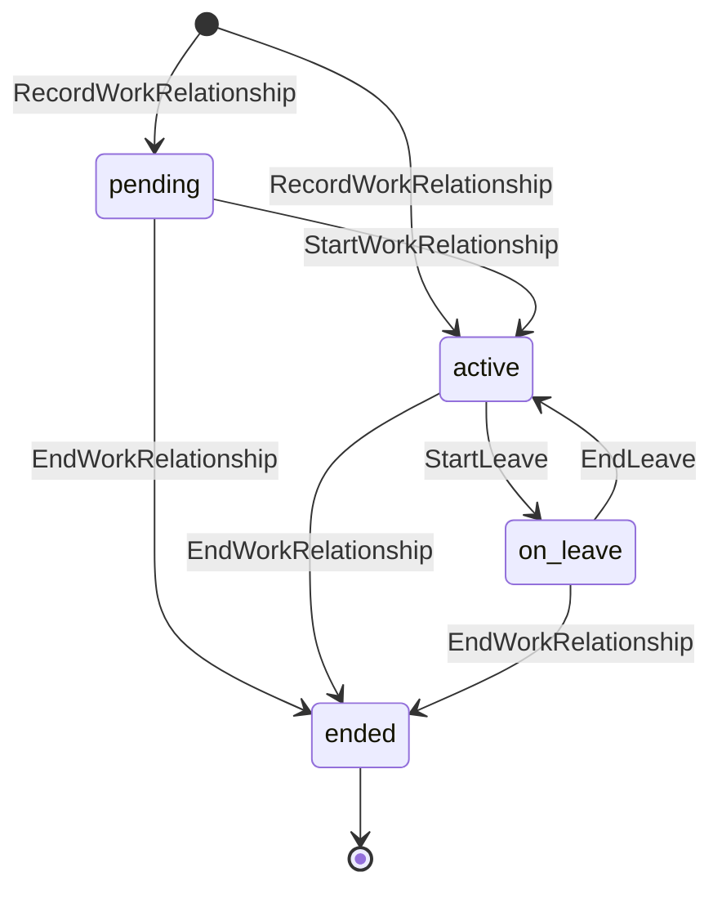
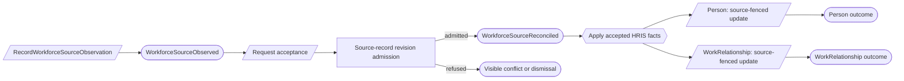
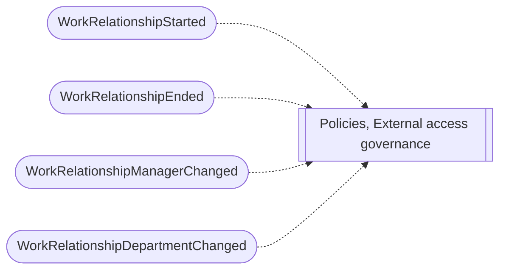

# Workforce assurance

Status: **under refinement**, 2026-11-05. Hand-authored source of truth for this context; the cross-context contracts and infrastructure qualifications below remain open.

## Purpose

Workforce assurance records who works for the organization, on what terms, and
which non-human identities exist and who is accountable for them (M0-D06). Other
contexts react to joiners, movers and leavers. Workforce records never grant
platform access, revoke outside access, or decide a review outcome.

**Owns:** people, work relationships, service identities (non-human identities),
and workforce source observations with their reconciliation.

**Does not own:**

| Concern | Owner |
| --- | --- |
| Platform members and sign-in | Platform access; a person is linked to members, never merged with them |
| Accounts and entitlements at outside systems | External access governance |
| Acknowledgement and training campaigns | Policies |
| Binding imported owner names to people | The importing context (Application inventory) |
| Roster file import | Deferred until the first client's HRIS export shape is known (#347) |

## Language

| Term | Meaning |
| --- | --- |
| Person | The stable identity of someone in the workforce. Never ended. |
| Work relationship | One person's employment or engagement under one worker identifier: worker type, status, dates, manager, department and, for external collaborators, a sponsor. |
| Worker identifier | The stable ID of a work relationship: the HRIS worker ID, or an organization-maintained ID for a manual roster. An external source ID is provenance only. |
| Worker type | `employee`, `contractor` or `external_collaborator`. |
| Service identity | A non-human identity (workload, service, automation, bot, integration, or shared account) with one accountable owner. |
| Source observation | One revision of one record from a workforce source (HRIS or identity-provider directory), waiting for or carrying a reconciliation decision. |
| Restricted workforce fields | Personal contact details, the reason for an employment status, and the manager chain. Readable only with an explicit grant; redacted from lists, exports, search and counts (M0-D06). |

## Aggregates

### Person

**Identity:** `TenantId` + `PersonId`.

**Invariant:** one person has one display name, one work email and optional
personal contact details (restricted). A person is never ended or retired
(WF-02). A person's linked members are a projection of independent `Member`
facts, not state or per-member history on `Person` (WF-05).

| Command | Who | Accepts when | Emits |
| --- | --- | --- | --- |
| RecordPerson | Compliance Lead or Org Admin, or reactor | `PersonId` is new | PersonRecorded |
| ChangePersonDetails | Compliance Lead or Org Admin, or reactor | Details differ | PersonDetailsChanged |

| Event | Carries |
| --- | --- |
| PersonRecorded | tenant, person, display name, work email, personal contact (restricted), recorded by |
| PersonDetailsChanged | tenant, person, changed fields, changed by |

### Member–Person association

**Identity:** `(TenantId, UserId)`, the existing platform-access `Member`.

**Invariant:** at most one Person is linked to a Member at a time; link and
unlink decisions are ordered with that Member's episode changes. This candidate
contract remains subject to the cross-context and policy qualifications below.

The platform access `Member` identified by `(TenantId, UserId)` owns its one
optional `PersonId` and link generation alongside its current membership
episode. It makes link, unlink, and episode changes in the same versioned
stream. Competing links therefore cannot both win. The target `Person` must
have an authoritative, committed `PersonRecorded` fact in the same tenant;
that existence is stable because a Person never ends. A projection is not proof
of existence. This association does not grant platform or business-record access.

An Org Admin requests a link with the expected current episode, the target
Person and a unique link generation. A current active or suspended episode is
required; stale episode commands are refused. An exact retry returns the original
operation's recorded outcome without applying the change again, while reuse of
an operation or generation for changed intent is refused. A historical success
does not assert that the link is still current. Linking a
different Person while linked is refused: unlink the exact current generation
first. Unlink carries the expected Person, link generation and episode, so a
late unlink cannot remove a later link even if the Person is the same. Unlinking
an already absent link is a no-op only for an exact retry, not a claim that an
unrelated operation succeeded. The `Member` records link and unlink facts with
tenant, user, Person, episode, generation and actor; a per-Person member list is
derived from these facts. This requires corresponding platform-access command
and event contracts; it does not add child facts to `Person`.

The candidate retains identity correlation on the stable Member when an episode
ends and a new episode begins. It never makes the new episode active
or transfers any grant. Consumers must independently enforce current-episode
authorization. A delayed link or unlink from an old episode is refused even if
the identity correlation survived. If product policy instead requires clearing
that correlation at deprovisioning, the clear must be ordered atomically on the
same Member stream; this policy is not implied by WF-05.

To resolve an old retry after later unlink and relink operations, current link
state is insufficient. The operation identity and original intent must resolve
to a retained, authoritative Member fact or an equally authoritative outcome;
an eventually consistent reverse-members projection is not that authority.
Until the lookup and retention guarantees are qualified, an ambiguous operation
stays pending rather than reporting a guessed success or issuing another link.
Link and unlink events are changes to this Member's own association, not a
Person-owned roster, but repeated episodes and link changes still increase the
Member stream that Portia replays. Their expected lifetime, replay cost and
recovery require qualification.

### WorkRelationship

**Identity:** `TenantId` + worker identifier. The worker identifier belongs to one
person for good.

**Invariant:** one relationship has one person, one worker type and one status
lifecycle. Its dates agree with its status: an ended relationship has an end
date that is not before its start date.

- Nobody is their own manager or sponsor.
- An external collaborator has an accountable internal sponsor, who must be a
  person with an active work relationship when named. If the sponsor later leaves,
  the collaborator shows as unsponsored work (WF-06).
- A rehire is a new work relationship; an ended one stays ended (WF-01).
- Each change is its own named fact, so other contexts react to exactly what
  changed (WF-03).

| Command | Who | Accepts when | Emits |
| --- | --- | --- | --- |
| RecordWorkRelationship | Compliance Lead or Org Admin, or reactor | Worker identifier is new; person exists | WorkRelationshipRecorded |
| StartWorkRelationship | Same | Pending | WorkRelationshipStarted |
| StartLeave | Same | Active | WorkRelationshipLeaveStarted |
| EndLeave | Same | On leave | WorkRelationshipLeaveEnded |
| EndWorkRelationship | Same | Not ended; end date not before start | WorkRelationshipEnded |
| ChangeManager | Same | Not ended; not self | WorkRelationshipManagerChanged |
| ChangeDepartment | Same | Not ended | WorkRelationshipDepartmentChanged |
| ChangeSponsor | Same | External collaborator; sponsor active; not self | WorkRelationshipSponsorChanged |
| CorrectWorkRelationshipDates | Same | Dates still agree with status; reason given | WorkRelationshipDatesCorrected |

| Event | Carries |
| --- | --- |
| WorkRelationshipRecorded | tenant, worker identifier, person, worker type, status, start date, manager (restricted), department, sponsor, source provenance, recorded by |
| WorkRelationshipStarted | tenant, worker identifier, start date |
| WorkRelationshipLeaveStarted | tenant, worker identifier, from date |
| WorkRelationshipLeaveEnded | tenant, worker identifier, return date |
| WorkRelationshipEnded | tenant, worker identifier, end date, reason (restricted) |
| WorkRelationshipManagerChanged | tenant, worker identifier, manager (restricted) |
| WorkRelationshipDepartmentChanged | tenant, worker identifier, department |
| WorkRelationshipSponsorChanged | tenant, worker identifier, sponsor |
| WorkRelationshipDatesCorrected | tenant, worker identifier, start date, end date, reason |

Every event also carries the actor who recorded it.

### ServiceIdentity

**Identity:** `TenantId` + `ServiceIdentityId`.

**Invariant:** one non-human identity has exactly one accountable owner (a person
or a team), an approved purpose, and a next review date at most one year after
its last review. It is active, disabled or retired; a retired identity accepts
no further changes.

- Its kind is workload, service, automation, bot, integration or shared account.
  A shared account also needs an accountable owner person and a justification,
  and is never treated as a human.
- Each annual review is recorded as a fact with the reviewer and the next review
  date (WF-04).
- An identity whose owner has left, or whose review date has passed, shows as
  unowned work. Retiring it does not change access at the outside service.

| Command | Who | Accepts when | Emits |
| --- | --- | --- | --- |
| RecordServiceIdentity | Compliance Lead or Contributor | `ServiceIdentityId` is new; rules hold | ServiceIdentityRecorded |
| ChangeServiceIdentityOwner | Compliance Lead | Not retired | ServiceIdentityOwnerChanged |
| ChangeServiceIdentityPurpose | Compliance Lead | Not retired | ServiceIdentityPurposeChanged |
| ReviewServiceIdentity | The owner, or Compliance Lead | Not retired; next date within one year | ServiceIdentityReviewed |
| DisableServiceIdentity | Compliance Lead | Active | ServiceIdentityDisabled |
| EnableServiceIdentity | Compliance Lead | Disabled | ServiceIdentityEnabled |
| RetireServiceIdentity | Compliance Lead | Not retired | ServiceIdentityRetired |

| Event | Carries |
| --- | --- |
| ServiceIdentityRecorded | tenant, identity, kind, name, owner, purpose, shared justification, next review date, recorded by |
| ServiceIdentityOwnerChanged | tenant, identity, previous owner, new owner, changed by |
| ServiceIdentityPurposeChanged | tenant, identity, purpose, changed by |
| ServiceIdentityReviewed | tenant, identity, reviewer, notes, next review date |
| ServiceIdentityDisabled | tenant, identity, reason, disabled by |
| ServiceIdentityEnabled | tenant, identity, enabled by |
| ServiceIdentityRetired | tenant, identity, reason, retired by |

### WorkforceSourceObservation

**Identity:** `TenantId` + source kind + source system + source record + source
revision.

**Invariant:** one observation of one source record revision is recorded once,
and receives at most one attributable reconciliation decision: `accepted` or
`dismissed`, with a note of 1–1000 characters.

- An HRIS observation is authoritative for people, employment status and manager.
  An identity-provider observation only corroborates; a disagreement shows as a
  conflict and is never resolved silently (M0-D06).
- Observations can be entered by a person, so the manual path works without a
  connected source.
- An HRIS acceptance requests admission from the source-record authority below.
  Only its committed admission establishes acceptance; a stale read cannot do
  so. An older, never-admitted revision is refused and may be dismissed (WF-08).
- An accepted revision is applied separately to the Person and WorkRelationship.
  Acceptance is not proof either target has applied it. Target-local fences
  prevent an older revision overwriting a newer revision already applied there.
- A new person and work relationship created by that reactor take IDs derived from
  the source record, so two revisions of a new worker produce one person
  ([CV-02](conventions.md#reactors), WF-08).

| Command | Who | Accepts when | Emits |
| --- | --- | --- | --- |
| RecordWorkforceSourceObservation | Compliance Lead, or a source integration | This revision is new | WorkforceSourceObserved |
| ReconcileWorkforceSourceObservation | Compliance Lead or Org Admin | Not reconciled; note given; dismissal is local; acceptance requires the source-record admission outcome | WorkforceSourceReconciled, or an admission request pending outcome |

| Event | Carries |
| --- | --- |
| WorkforceSourceObserved | tenant, source, record, revision, observed facts, matched person and worker identifier (if any), recorded by |
| WorkforceSourceReconciled | tenant, source, record, revision, decision, note, decided by, acceptance admission identity when accepted |

An acceptance request reserves this observation's reconciliation while the
admission outcome is unknown: dismissal and a different acceptance intent cannot
race it. After admission it must converge to the accepted decision, including
after a crash. A refused admission releases the pending request so the person
can dismiss or resolve the conflict. An exact request retry recovers the same
outcome; a different request is not silently treated as that retry.

### WorkforceSourceRecord admission

**Identity:** `(TenantId, source kind, source system, source record)`.

**Invariant:** newly admitted revisions for this source record increase
monotonically, as decided by its versioned admission stream. This candidate
guarantee requires the source-ordering and atomic-append qualifications below.

This is the authority for the greatest accepted revision of that one source
record. It retains that scalar revision and enough identity to recognize an
exact current retry, not a list of observations or affected people. Its own
append history records admissions; it is not a roster of child changes. That
history can grow with the record's own revisions: fixed-size decision state is
not a claim that its lifetime event stream has a fixed size.

Every provider must define an immutable, totally ordered revision for a record.
Same revision with changed content is a conflict, not a retry; incomparable or
untrustworthy provider revisions remain unresolved until a source-specific
ordering contract exists. A manual path must provide an equivalent ordering
authority. Concurrent admission requests compare the proposed revision with the
greatest admitted revision and append against the same stream version: a higher
revision is admitted, a lower never-admitted revision is refused, and an exact
retry resolves to its original outcome. A changed-intent retry is refused.
The admission fact identifies the observation, revision, payload identity,
request and attributable decision. The observation records acceptance only on
that participant outcome. Admission is not undone if delivery is delayed; an
unknown result remains pending and is recovered from durable evidence, not
guessed. Implementation must qualify a bounded-memory, authoritative way to
find an older admission by request identity after later revisions advance the
gate; the current latest revision alone cannot distinguish its retry from a new
stale request.

Each target atomically binds at most one authoritative source record for its
source-owned fields, and stores that binding and its greatest applied revision.
For a new target, creation, source binding and the first applied revision commit
together against that target's identity; conflicting creation attempts cannot
both win.
An update carries the source identity, revision, exact request identity, and a
complete snapshot of the source-owned fields for that target, not merely a
delta. It applies only to the matching binding and a greater revision; same
revision with the same intent is a no-op, and changed intent or a different
source is a conflict requiring explicit resolution. Thus target state is fixed
per target rather than a map of all source records. Source binding or migration
must be decided by that target; unresolved collisions stay visible and do not
overwrite facts. Manual and user-owned fields are preserved, and precedence for
every field must be specified before implementation.

There is no atomic commit across the gate and targets. An older admitted update
may apply to a target after a newer revision is admitted but before that newer
revision reaches it; the target remains pending until the newer revision has
its own durable outcome. Once a target applies the newer revision, its own fence
refuses the old one. Independent per-revision/per-target outcomes, retries and
conflicts are recorded without a source-record-owned target list; an unknown
outcome is not success. If stronger immediate visibility is needed, this
eventual guarantee is insufficient and requires an explicitly designed
coordination or transaction mechanism.

## Flows

### Reconciling a source observation

The reactor runs only for an `accepted` HRIS observation. Each target applies a
complete source-owned snapshot atomically and emits the individual named domain
facts for changes it actually accepted. The two targets may complete at
different times; their outcomes and conflicts remain separately visible.

### Joiners, movers and leavers

Workforce assurance has no reactions of its own to these facts. The consuming
contexts design theirs, and they never change platform or outside access
automatically.

## Authorization contract

- Restricted workforce fields need an explicit permission, granted by default to
  Org Admin and Compliance Lead. Lists, exports, search and counts redact them.
  Server-side rules, such as reviewer assignment, may use them without revealing
  them (M0-D06).

## Decisions

Jev answers are from `jev-1.14.0`, 2026-11-03. A yes is ≥ 0.8 and a no is ≤ 0.2.
Anything in between is settled by common sense, with the reasoning stated.

| ID | Decision | Evidence |
| --- | --- | --- |
| WF-01 | A rehire is a new work relationship. | 0.86. |
| WF-02 | A person is never ended; endings belong to the work relationship. | 0.89. |
| WF-03 | Work relationships record named facts for each change, not one generic revision. | 0.63. Common sense: policy campaigns and access reviews react to specific changes (leaver, manager change), and the user prefers clean, concise aggregates. Settles the old OPEN_LifecycleFactsOtherInventories for Person, WorkRelationship and ServiceIdentity. |
| WF-04 | Each annual service-identity review is a fact with reviewer and next review date. | 0.70. Common sense: auditors need evidence that the annual review happened. |
| WF-05 | A member is linked to at most one person, but a person may have several linked members. | One-to-one both ways: 0.32. Common sense: one person can have more than one account, but one account is never two people. |
| WF-06 | A sponsor must be active when named; a later departure shows as unsponsored work rather than blocking anything. | Sponsor must be active: 0.43. Same treatment as a service identity whose owner leaves (M0-D06). |
| WF-07 | One observation carries its own reconciliation; source-record admission is a separate authority for ordering revisions. | The old `WorkforceObservationResolution` duplicated the observation's decision; independent observations cannot decide record-wide ordering. |
| WF-08 | A source-record owner refuses a newly requested older revision; each target independently fences application and records its outcome. New people and work relationships take IDs derived from the source record. | Flow audit G5; [boundary review](../reviews/workforce-boundaries.md); CV-02. |

## Open questions

- The candidate platform-access `Member` association commands, events,
  generation and episode rules require cross-context and runtime qualification;
  the product policy for retaining the link across deprovisioning needs explicit
  confirmation before implementation.
- Qualify provider revision ordering, field ownership and source binding/migration,
  recovery of old admission outcomes, target idempotency, and the atomic target
  fence in the actual framework. The single-source-per-target restriction may
  require a product decision when multiple sources contend for one Person.

## Superseded owners

| Old owner | Becomes |
| --- | --- |
| Person | Person (member links owned by `Member`; WF-05) |
| WorkRelationship | WorkRelationship (named facts; WF-03) |
| ServiceIdentity | ServiceIdentity (named facts and reviews; WF-03, WF-04) |
| WorkforceSourceObservation, WorkforceObservationResolution | WorkforceSourceObservation and WorkforceSourceRecord admission (WF-07, WF-08) |
| WorkforceRosterSnapshotProcess | Deferred with roster import (#347) |
| ImportedOwnerResolution | Moves to Application inventory |
