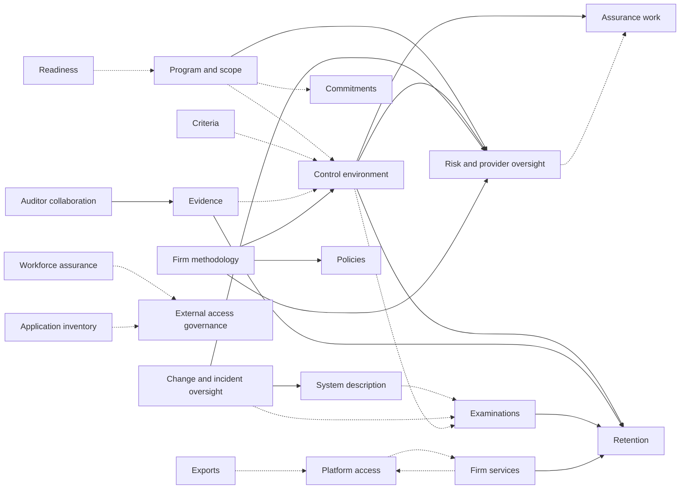

# Compliance domain model

Status: authoritative overview, 2026-11-03. The write model itself is in the
[context docs](contexts); each one is the source of truth for its aggregates,
commands, events, reactions, flows and decisions. This page gives the shared
rules and the map between contexts.

## Modeling rules

- Model the compliance process, not a collection of independent CRUD screens.
- Keep definitions, performances, evidence, reviews, decisions, and snapshots
  distinct even when the UI presents them together.
- Give every business record a stable platform identity. Names, email
  addresses, filenames, and provider display values are attributes, not keys.
- Preserve effective history. A correction creates a revision, amendment, or
  superseding record instead of changing completed audit history in place.
- Treat every status as a projection from inspectable business records and
  rules. A status is never an unexplained manual flag.
- Keep authorization and work responsibility distinct. Permission to perform
  an action does not by itself assign the action to someone.
- Preserve source provenance for imported, collected, advisor-authored, and
  auditor-authored material.
- Keep every workflow usable through authorized user actions when integrations
  are absent or disabled.
- Scope every business record to exactly one client organization (tenant).
  Only platform-level content (criteria editions, methodology templates, the
  firm-staff directory and the operator roster) exists outside a tenant, and it
  never contains client data (M0-D25).
- Every stream stays short enough to replay for the life of its record: a wide
  or long-lived record keeps only its real invariant, and volume lives in
  per-item or per-draft streams ([CV-13](contexts/conventions.md#stream-growth)).
- One small aggregate per domain noun, named in the product's terms. Rules that
  span aggregates are current-state checks
  ([conventions](contexts/conventions.md)).

## Process spine

```text
Client organization (tenant) and membership
  -> Program and system boundary
  -> Workforce, application, technology, information and provider inventories
  -> Commitments, system requirements and risk assessment
  -> Criteria edition
  -> Controls, mappings, responsibilities and occurrences
  -> Evidence and its support for occurrences
  -> Reviews and decisions
  -> Findings, waivers, corrective actions and risk acceptances
  -> Readiness assessment and the Type I entry decision
  -> Examination baseline or observation period close
  -> Audit package and outcome
  -> Next period
```

## Bounded contexts

| Context | Owns |
| --- | --- |
| [Platform access](contexts/platform-access.md) | Tenants and their slugs, invitations, members, teams, roles, primary Org Admins, platform users, sign-in identities, the platform operators record, firm staff, separation-of-duties waivers |
| [Firm services](contexts/firm-services.md) | Service engagements, staff assignments, client practice compartments, nonattest service records, independence rule sets and evaluations, partner designations, attest record packages |
| [Firm methodology](contexts/firm-methodology.md) | Platform-level methodology templates and their application to programs |
| [Program and scope](contexts/program-and-scope.md) | Programs, stages, target dates, system boundaries, client services |
| [Workforce assurance](contexts/workforce-assurance.md) | People, work relationships, service identities, workforce source observations |
| [Application inventory](contexts/application-inventory.md) | Applications, system instances, access-review scope |
| [Technology and information inventory](contexts/technology-and-information-inventory.md) | Technology components, information assets, data flows, locations, operational processes |
| [Commitments](contexts/commitments.md) | Commitments (service commitments, system requirements, CUECs, CSOCs) and their links to controls |
| [Criteria](contexts/criteria.md) | Criteria editions, criteria, licensed text overlays, applicability |
| [Control environment](contexts/control-environment.md) | Controls, mappings, responsibilities, occurrences, evaluation plans and evaluations |
| [Evidence](contexts/evidence.md) | Artifacts, redactions, requests, support links, disclosures |
| [Retention](contexts/retention.md) | Artifact retention, the hold register (legal and engagement holds, disposal authorization), dispositions |
| [Assurance work](contexts/assurance-work.md) | Findings, corrective actions, waivers |
| [Policies](contexts/policies.md) | Policies, training requirements, acknowledgement and training campaigns |
| [Risk and provider oversight](contexts/risk-and-provider-oversight.md) | Risk method, risks, assessments, treatments, acceptances, triggers; providers, assurance reports, reviews, coverage gaps |
| [External access governance](contexts/external-access-governance.md) | Access expectations, populations, account classifications, review campaigns and items |
| [Change and incident oversight](contexts/change-and-incident-oversight.md) | Changes and compliance incidents |
| [System description](contexts/system-description.md) | System description versions and section reviews |
| [Readiness](contexts/readiness.md) | Readiness assessments, gap plans, Type I entry decisions |
| [Examinations](contexts/examinations.md) | Examinations, Type I baselines, Type II plans, observation periods, assertions, representation letters, outcomes, audit test exceptions, sign-offs |
| [Auditor collaboration](contexts/auditor-collaboration.md) | Auditor requests, responses and comments, audit populations, sample selections, audit packages |
| [Advisor collaboration](contexts/advisor-collaboration.md) | Advisor handoffs and feedback |
| [Exports](contexts/exports.md) | Client exports |
| [Work queue](contexts/work-queue.md) | Work item assignments, digest preferences, weekly digests |
| Organization commercial operations | Not designed yet: subscription, billing and add-ons await the business-operations decisions |

## Context map

The main facts that cross context boundaries. A solid arrow is a reaction that
issues a command in the target; a dotted arrow is a fact the target reads in a
guard or a computed gap.



## Decision records

Product decisions are in [decisions](decisions); each context's decision table
cites the ones it applies. The [flow audit](flow-audit-2026-11-03.md) records
the cross-context problems the conventions fixed.
