# Flow audit: command → aggregate → event → reactor → command

Date: 2026-11-03. Status: **resolved in the context docs**. See
[Resolution](#resolution). Scope: the first nine hand-authored context docs in
[contexts](contexts). The generated `reactors/` and `processes/` pages it also
covered were retired later the same day, when every context was locked.

Notation used in every diagram below (same as the context docs):

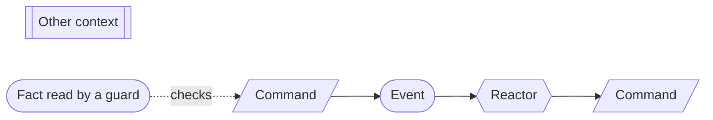

The dotted `checks` edge is new. Most flows here have no reactor and are held
together only by guards that read other aggregates' current state. Without that
edge, a diagram shows a list of unrelated commands and you can't see the order
it enforces. Each corrected diagram below uses it.

## Summary

| Severity | Count | Meaning |
| --- | --- | --- |
| Broken | 8 | A flow dead-ends, or a stated invariant can be violated through a path the doc allows |
| Gap | 13 | A rule is stated but no command at the owning boundary enforces it, or a reactor can't act on what its trigger event carries |
| Contract | 2 | Missing event tables or undefined names |
| Accepted | 1 | A trade-off that follows the small-aggregate rule; listed, not a finding |

Flow inventory (25 flows):

| Context | Flow | Diagram | Verdict |
| --- | --- | --- | --- |
| Platform access | Organization creation | yes | **Broken**: B1 |
| Platform access | slug change | yes | OK |
| Platform access | Invitation and joining | yes | **Broken**: B3. Gaps: G7, G8 |
| Platform access | First sign-in | yes | Gap: G10 |
| Platform access | Account recovery | yes | Gap: G9 |
| Platform access | Membership ends | yes | OK |
| Platform access | Role or team deleted | yes | **Broken**: B2, B8 |
| Platform access | Offboarding | yes | Gap: G1 |
| Firm services | Advisory engagement | yes | **Broken**: B7. Gap: G6 |
| Firm services | Attest engagement acceptance | yes (disconnected) | OK; needs check edges |
| Firm services | Attest engagement closure | yes | OK |
| Firm services | Firm staff leaves | yes | Gap: G13 |
| Program and scope | Boundary approval | yes (disconnected) | Gap: G12 |
| Workforce assurance | Reconciling a source observation | yes | Gap: G5 |
| Workforce assurance | Joiners, movers, leavers | yes (external only) | OK; consumers not designed yet |
| Application inventory | Merging duplicate applications | yes | **Broken**: B6. Gap: G7 |
| Application inventory | Retiring an application | yes | OK |
| Technology and information | none (no reactors) | n/a | OK |
| Examinations | Type I examination | yes (disconnected) | **Broken**: B4, B5. Gap: G2 |
| Examinations | Type II examination | yes (disconnected) | **Broken**: B4, B5. Gaps: G3, G4 |
| Examinations | Next period | **no** | Needs a diagram |
| Auditor collaboration | Request and response | yes (disconnected) | OK |
| Auditor collaboration | Population and sample | yes (disconnected) | OK |
| Auditor collaboration | Package | yes | **Broken**: B8. Gap: G11 |
| Commitments (draft) | Approving / changing a commitment | yes (disconnected) | Gap: G12 |

## Broken

### B1. A rejected first slug strands the organization

`TenantRegistered` → claim → `TenantSlugClaimDenied` →
`TenantSlugRejected`. The doc says the creator then calls
`RequestTenantSlugChange`. That command accepts only when the tenant is
**Active**, and the authorization contract requires an active tenant for any
action. The tenant stays `registered` for good.

**Fix:** `RequestTenantSlugChange` accepts in `registered` or `active`
when no claim is pending. Authorization lets the creator issue this one command
while the tenant is `registered`.

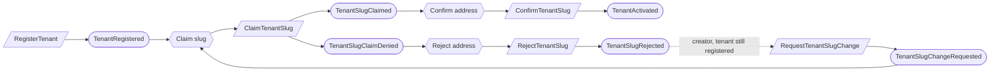

(The built-in role, team and creator branches are unchanged. See B8 for their
names.)

### B2. The last Org Admin can be removed through another team

PA-04 refuses `SuspendMember`, `DeprovisionMember` and removal from the
Administrators team for the last active Org Admin. PA-12 also allows Org Admin
to be assigned, at organization scope, to **any** team. If "active Org Admin"
counts those teams, this path is open:

1. Alice is on Administrators. Bob is on "Ops", which holds Org Admin.
2. Remove Alice from Administrators. This is allowed because Bob is still an Org Admin.
3. `DeleteTeam(Ops)` or `RemoveRoleFromTeam(Ops, Org Admin)`. Neither checks.
4. The organization has no Org Admin.

**Fix (recommended):** define "active Org Admin" for PA-04 as *an active member
of the Administrators team*. The three guarded commands are then sufficient, and
Org Admin on other teams adds permission but never counts towards continuity. The
alternative is to also guard `DeleteTeam` and `RemoveRoleFromTeam`, which adds
two more cross-aggregate checks.

### B3. An invitation to a suspended member dead-ends

`InviteMember` refuses only *active* members. `RegisterMember` accepts only when
there is *no current episode*, and a suspended episode is current. A suspended
member can therefore be invited and can accept, and then `RegisterMember` is
refused. The result is an accepted invitation with no membership.

**Fix:** `InviteMember` refuses when the user's current episode is active **or
suspended**. Reinstatement is the path back for a suspended member.

### B4. The signing chain doesn't depend on the baseline or the period close

The Type I flow shows `TypeIBaselineFrozen` with a dotted line to "package
validated". No command reads it: `ValidateAuditPackage` doesn't require a frozen
baseline, and `SignManagementAssertion` requires only a validated package. A Type
I can therefore be signed off with no baseline. Type II has the same hole: nothing
in the chain requires `ObservationPeriodCloseApproved`.

**Fix:** `SignManagementAssertion` requires, for Type I, a frozen baseline version
contained in the validated package. For Type II, it requires an approved period
close contained in the validated package. The assertion event records which one.

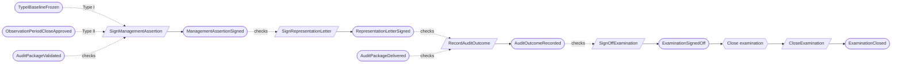

### B5. "Acknowledge each unresolved material item" has no command

`ApproveObservationPeriodClose` and `SignOffExamination` both accept only when
"every unresolved material item is acknowledged". No command or event records an
acknowledgement, so the guard can never pass.

**Fix (recommended):** the acknowledgements are part of the command payload. The
signer acknowledges each listed item by ID in the same command, the command is
refused unless the set matches the frozen close's list exactly, and the event
carries them. This adds no new aggregate or command.

### B6. A merge chain strands system instances on a retired application

Suppose `MergeApplication(A → B)` and then `MergeApplication(B → C)`, before A's
move reactor runs. `MoveSystemInstance` accepts when the instance is "owned by
the merged application" and moves A's instances to B, which is retired. B's own
move reactor has already run, so those instances stay on a retired application
for good. That breaks "every active instance belongs to an active application".

**Fix:** the move reactor resolves `merged_into` to the live survivor when it
issues the command. Separately, `MoveSystemInstance` refuses a retired target.

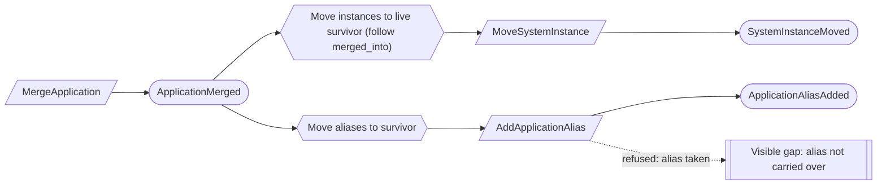

### B7. An impairing service recorded during an attest engagement goes unnoticed

FS-04 is enforced only on `AcceptServiceEngagement` (advisory). An engagement
partner can still record an outside-product impairing service, or revise a
record's kind or dates into an open attest engagement's period, through
`RecordNonattestService` or `ReviseNonattestService`. Nothing reacts. The firm
then continues an attest engagement whose independence is impaired by its own
records.

**Fix:** keep recording the truth (as TI-02 does; don't block it). The open attest
engagement shows an `independence_impaired` gap, computed from the history and
the evaluation's rule set. Decide whether that gap blocks
`AssignEngagementStaff` and `RecordAuditOutcome`. That is an open question for
Firm services, worth a Jev check.

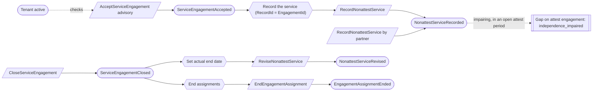

### B8. The package build can archive stale contents

`ChangeAuditPackageContents` accepts while `assembling`, and after
`RequestAuditPackageBuild` the package is still `assembling`. A contents change
that lands after the build request means `AuditPackageBuilt` archives a different
set of contents than the package now lists. Validation checks manifest entries,
not that they match the contents, so the mismatch is validated and signed for.

**Fix:** `AuditPackageBuildRequested` records the contents revision.
`RecordAuditPackageBuilt` is refused unless it built that revision and it is still
current. Alternatively, `ChangeAuditPackageContents` is refused once a build is
requested. Either way, add the build-requested step to the state diagram.

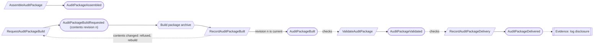

## Gaps

**G1. Tenant lifecycle isn't checked by Firm services.** Platform access says
"offboarding forbids new active service". However, `ProposeServiceEngagement`,
`AcceptServiceEngagement` and `AssignEngagementStaff` don't read tenant state.
The doc also doesn't say whether open advisory engagements must close before
`CompleteTenantOffboarding`. Fix: those three commands require an active tenant,
and offboarding completion also requires that no engagement is accepted and
still open.

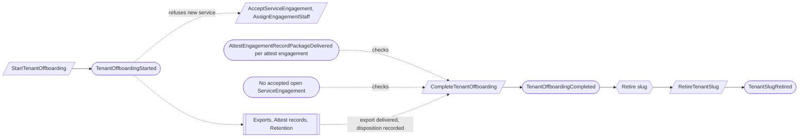

**G2. The signing chain binds "the" assertion, letter and outcome, but several
can exist.** A changed assertion is a new assertion, and a reissued report is a
new outcome. The letter, the outcome and the sign-off must name the exact
predecessor IDs they rely on. Also, the AuditOutcome invariant says "exact
*delivered* package version", but its guard checks only "letter signed". Add the
delivery check, as in B4's diagram. Separately, `ExaminationSignOff` is one per
examination, so the doc should say what a reissued outcome after sign-off means:
a new sign-off, or nothing.

**G3. More than one approved Type II plan or period per examination.**
`ProposeTypeIIPlan` doesn't refuse when the examination already has an approved
plan, and `StartObservationPeriod` doesn't refuse a second period for the same
examination. Fix: one approved plan per examination and one period per
examination, both checked against current state.

**G4. There are three sources of period dates.** These are Examination target and
confirmed dates, the TypeIIPlan dates, and the ObservationPeriod dates
(`ChangeObservationPeriodDates`). Nothing reconciles them. Also,
`ObservationPeriodDatesChanged` has no consumer, but Control environment opened
occurrences from the original dates. Fix: name the ObservationPeriod as
authoritative once it starts, and send `ObservationPeriodDatesChanged` to Control
environment alongside `ObservationPeriodStarted`.

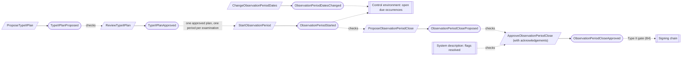

**G5. Workforce reconciliation applies stale or duplicate facts.** Accepting an
older revision after a newer one has been applied overwrites newer HRIS facts.
Two revisions of a new worker, both recorded before either is applied, carry no
matched person, so the reactor records two people. Fix: the reactor skips a
revision older than the last applied revision for that source record. It derives
`PersonId` and the worker identifier from the source record, not a fresh ID.

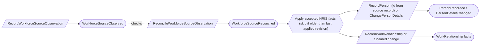

**G6. Reactors that mint IDs aren't idempotent.** With at-least-once delivery, a
redelivered trigger creates a second record. This affects `RegisterPlatformUser`
(first sign-in), `RecordNonattestService` (advisory acceptance), `RecordPerson`
(G5) and `RegisterMember` (creator). Fix, as one rule in
the [context conventions](contexts/conventions.md#reactors): a reactor derives the
new ID from its trigger, for example `RecordId = EngagementId`. That also lets the
closure reactor find the record to revise without a query.

**G7. Reactor refusals have no defined outcome.** Several reactor commands can be
refused by a guard that went false between the trigger and the command:

- `AddApplicationAlias`: the alias was taken in the window.
- `AssignTeamMember`: the invited team was deleted.
- `RegisterMember`: see B3.
- `MoveSystemInstance`: see B6.
- `ConfirmTenantSlug`: the tenant changed state.

Fix, as one rule: a refused reactor command is final, is not retried, and shows
as a visible gap. It is never silently dropped. `AssignTeamMember` should also
refuse a deleted team, which it doesn't check today.

**G8. `MemberRegistered` doesn't say where the member came from.** "Join invited
teams" and "Put creator on Administrators" both trigger on `MemberRegistered`, but
the event carries neither the invitation offer nor a creator flag. Fix: add
`origin` (`tenant_creation` or the invitation offer). The teams are then read from
that offer.

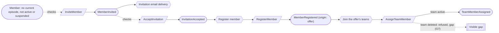

**G9. Account recovery revokes identities on the wrong trigger.** "Revoke other
identities" fires on `SignInIdentityAttached`, which every first sign-in also
emits. Fix: trigger it on `AccountRecoveryVerified`, which names the user and the
identity to keep.

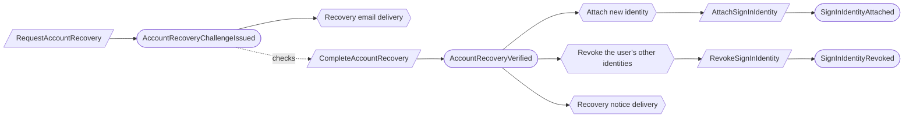

**G10. The email challenge has no way to be answered.** `IssueEmailChallenge`
exists, but no command completes it, and the first sign-in diagram omits the
branch. Fix: add `CompleteEmailChallenge` → `EmailAddressVerified` on
`EmailAddress`. Its reactor then issues `ClaimEmailAddress`.

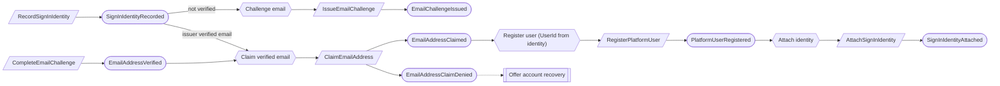

**G11. Redelivering a validated package doesn't recheck artifacts.** Deliveries
are unlimited (AC-04). An artifact that is quarantined, or put under a disposal
decision, after validation can be delivered again. Fix: `RecordAuditPackageDelivery`
rechecks shareability, or Evidence's quarantine marks the package undeliverable.
Decide this when Evidence is designed.

**G12. "Not the author" is ambiguous when a draft has several authors.** This
applies to `ReviewBoundaryDraft`, `ReviewTypeIIPlan` ("not the proposer") and
`ReviewCommitmentDraft`. Each draft can be revised by several people. Fix
(recommended): the reviewer has authored no revision of the draft, unless a waiver
covers it. Also, the `ReviewBoundaryDraft` command table omits the waiver
exception that its aggregate text grants.

**G13. A partner designation outlives the firm-staff entry.** When a staff member
becomes inactive, their `PartnerDesignation` stays. Partner-only commands
(ratifying rule sets, accepting engagements, approving evaluations) don't recheck
active firm staff. Fix: partner authorization requires an active `FirmStaffMember`
(the same approach as PA-09), so no reactor is needed.

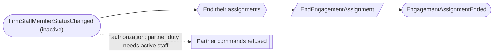

**Also check:** `OpenExamination` and `ChangeExaminationAuditor` can name a
`ServiceEngagement`, and that reference drives attest-staff authorization in
Auditor collaboration. They should require an accepted, open **attest**
engagement in the same tenant.

## Contract

**K1. Undefined names.** The "Role or team deleted" diagram uses
`RemoveMemberFromTeam` → `MemberRemovedFromTeam`, but the aggregate defines
`RemoveTeamMember` → `TeamMemberRemoved`.

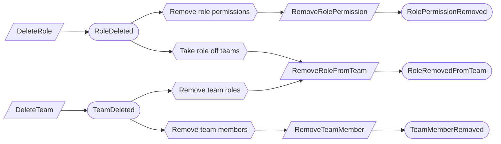

**K2. Aggregates with no event table.** The emitted event names exist, but their
payloads don't. Reactors and guards in this audit depend on those payloads (G2,
G8, G9). The affected aggregates are:

- WorkspaceWebAddress, SignInIdentity, EmailAddress, PlatformUser,
  SeparationOfDutiesWaiver, and FirmStaffMember. FirmStaffMember also has no
  "Accepts when" column. SeparationOfDutiesWaiver also has no revoke command.
- TypeIIPlan, ObservationPeriod, ManagementAssertion, RepresentationLetter,
  AuditOutcome, AuditTestException, and ExaminationSignOff.
- AuditorRequestComment.
- All five Technology and information aggregates, which are covered by one
  generic sentence.

## Accepted trade-offs (not findings)

These cross-aggregate rules are plain current-state checks, and two concurrent
commands can both pass them:

- the last Org Admin and the last operator
- name uniqueness for applications, locations and processes
- period overlap
- person exclusivity
- one superseding population
- "no draft responses" on request close
- unique commitment identifiers

This follows the small-independent-aggregates rule. The duplicate cases have a
repair path (merge, rename). The last-admin and last-operator cases have none, so
they are worth a one-line note in PA-04 and PA-20.

## Cross-context edges not yet designed

These are expected given the design order, and they are the checklist for the
next contexts. Solid edges are emitted facts. Dotted edges are guards that read
another context.

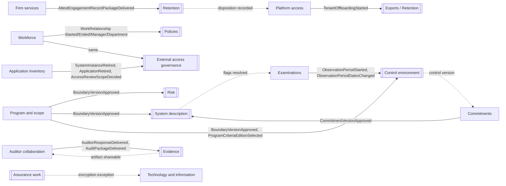

`ProgramCriteriaEditionSelected` has no consumer named anywhere. Criteria or
Control environment should own the reaction.

## Generated input that still names superseded owners

- `reactors/control-occurrence-fan-out-reactor.md` and
  `reactors/open-due-control-work-reactor.md` take their source from
  `TypeIIPeriod`. It is now `ObservationPeriod` / `ObservationPeriodStarted`.
- In `reactors/unassigned-domain-choreography.md`, row A001 targets
  `FirmStaffRecord`, which is superseded by FS and PA-06. Rows A018 to A020 target
  the `TypeIIPeriod` calendar, which EX-06 removed.

Resolved: these pages were deleted when every context was locked.

## Missing diagram

Examinations → "Next period" has prose and no diagram:

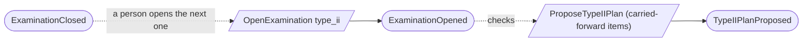

## Resolution

All findings were fixed in the context docs on 2026-11-03. The shared rules are in
[context conventions](contexts/conventions.md). Jev numbers are on each decision
row.

| Finding | Fixed by | Jev |
| --- | --- | --- |
| B1 rejected first slug | PA-21 | 0.75 |
| B2 last Org Admin via another team | PA-23 | near-even; common sense |
| B3 invitation to a suspended member | PA-22 | 0.60; common sense |
| B4 signing chain not tied to baseline or close | EX-11 | 0.84 |
| B5 no acknowledgement fact | EX-10, new `MaterialItemAcknowledgement` | 0.80 |
| B6 merge chain strands instances | AI-07 | 0.66; common sense |
| B7 impairing service during attest | FS-11, CV-08 | 0.89, 0.83, 0.92 |
| B8 stale package build | AC-07 | 0.79 |
| G1 tenant lifecycle in Firm services | PA-26, Firm services guards | 0.79 |
| G2 exact predecessors, reissued report | CV-07, EX-12 | 0.71 harm if skipped |
| G3 one plan and one period per examination | EX-09 | 0.66; common sense |
| G4 sources of period dates | EX-08 | n/a |
| G5 stale or duplicate HRIS facts | WF-08, CV-02 | 0.81 |
| G6 reactor-minted IDs | CV-02 | 0.82 |
| G7 reactor refusals | CV-03, `AssignTeamMember` team-active guard | 0.90 |
| G8 member origin | `MemberRegistered` origin, CV-04 | n/a |
| G9 recovery revocation trigger | Account recovery flow | n/a |
| G10 email challenge answer | `CompleteEmailChallenge`, `RecordIssuerVerifiedEmail` | n/a |
| G11 redelivery recheck | AC-08 | 0.79 |
| G12 reviewer independence | CV-06 | 0.79 |
| G13 partner after leaving | FS-12 | 0.78 |
| Engagement reference on examinations | EX-13 | 0.81 |
| K1 undefined names | Role or team deleted flow | n/a |
| K2 missing event tables | Event tables in every context | n/a |
| Disconnected diagrams | CV-01 dotted `checks` edges in every flow | n/a |
| `ProgramCriteriaEditionSelected` consumer | Criteria edition change flow (Program and scope) | n/a |

Also renamed: `WorkspaceWebAddress` became `TenantSlug` (PA-25).

Nothing is still open. The generated pages that named superseded owners were
deleted when every context was locked.

Every Mermaid diagram in `contexts/` and this file parses with Mermaid 11.4.1.
